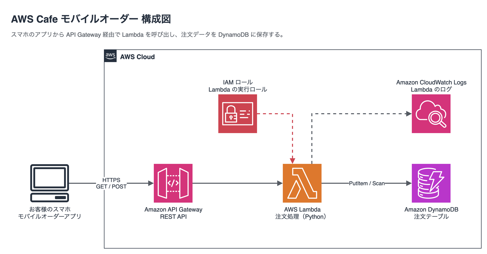

# ☕ AWS Cafe 開店前トラブルを解決せよ！

サーバーレスの障害対応を、初心者がストーリー仕立てで体験するハンズオン教材です。

人気カフェ「AWS Cafe」の新しいモバイルオーダーアプリは、開発担当のパソコン（ローカル）では完璧に動いていた。ところがリリース当日、それをそのまま AWS に載せたら、開店1時間前に止まってしまった。参加者は呼ばれた AWS エンジニアとして、開店までにアプリを直します。

## 構成図



元の図は [docs/images/architecture.drawio](docs/images/architecture.drawio) です。draw.io（diagrams.net）で開いて編集できます。

## チャレンジ

| # | 難易度 | 症状 | 学べること |
|---|---|---|---|
| 1 | ★☆☆ | メニューが表示されない！ | Lambda、CloudWatch Logs |
| 2 | ★★☆ | 予約の伝票が届いているはずなのに、画面に表示されない！ | DynamoDB、IAM ロール、最小権限 |
| 3 | ★★★ | お店の端末では動くのに、お客様のスマホから注文できない！ | API Gateway、GET と POST、CORS、デプロイ、開発者ツール |
| 4 | FINAL | 開店！最初のお客様の注文を通せ！ | API → 処理 → DB の全体像 |

## 進め方

運営が事前に環境を用意し、それを壊しておきます。参加者は壊れた環境に入って直す、という流れです。

1. 運営が、AWS から払い出されたアカウントに CloudFormation で正常なアプリをデプロイする
2. 運営が CloudShell でスクリプトを叩き、障害を仕込む
3. 参加者がアカウントにログインし、マネジメントコンソールで原因を調べて直す
4. 直したらお客様アプリの「クリア判定」で確認。4つ目をクリアすると「開店成功！🎉」が出る

## ドキュメント

参加者向け

- [00. ストーリーと構成](docs/00-story-and-architecture.md)
- [01. はじめに（ログインとアプリの準備）](docs/01-getting-started.md)
- [Challenge #1 メニューが表示されない！](docs/challenge-1.md)
- [Challenge #2 伝票が表示されない！](docs/challenge-2.md)
- [Challenge #3 お客様のスマホから注文できない！](docs/challenge-3.md)
- [Challenge #4 開店！最初のお客様の注文を通せ！](docs/challenge-4.md)
- [解答と解説](docs/answers.md)（イベント終了後に公開）

運営向け

- [運営ガイド（事前準備・当日の進行・トラブル対応・片付け）](docs/facilitator-guide.md)

参考（今回は使わない）

- [スコアボード（得点・ランキング）の参考実装](extras/scoreboard/README.md)

## ファイル構成

```
cfn/aws-cafe.yaml            正常な AWS Cafe 環境（API Gateway + Lambda + DynamoDB）
docs/images/                 構成図（architecture.drawio と、書き出した architecture.png）
lambda/broken/index.py       障害入りの Lambda コード（break スクリプトが使う）
scripts/deploy.sh            チームごとに環境をデプロイ
scripts/break-environment.sh 環境に障害を仕込む
scripts/verify.sh            各チームの状態（どこが壊れているか）を確認
scripts/fix-environment.sh   障害を直す（解答・リハーサル・救済用）
scripts/print-urls.sh        参加者に配るチーム専用アプリ URL を出力
app/index.html               お客様アプリ（注文・伝票・クリア判定・ヒント・開店成功演出・ローカル版）
ops/countdown.html           「開店まであと○分」投影画面
extras/scoreboard/           （今回は未使用）得点・ランキングの参考実装。他企画用
```

## ローカル版を見る

AWS の環境がなくても、ブラウザで次の URL を開くだけで、お客様アプリを動かせます。何もインストールしなくて大丈夫です。

https://sho-taka4423.github.io/aws-cafe-serverless-handson/app/index.html?local=1

ストーリー上は「開発担当のパソコンで正常に動いていたお店」です。メニューの表示、注文、伝票の表示という、正常な状態を一通り触れます。データはブラウザに保存され、AWS には一切接続しません。

ローカル版は、お店の画面（メニュー・注文・伝票）だけを表示します。ミッションは出ません。伝票を最初の予約3枚に戻したいときは、伝票欄の「伝票を最初の状態に戻す」を押してください。

## 動かし方

自分の AWS アカウントに障害入りの環境を作り、ハンズオンを最初から動かす手順です。作業は AWS の CloudShell とブラウザだけで済み、手元の PC に何かを入れる必要はありません。お客様アプリは GitHub Pages（https://sho-taka4423.github.io/aws-cafe-serverless-handson/app/index.html）で公開しているものを使います。

### 1. 障害入りの環境を作る（CloudShell）

1. AWS マネジメントコンソールにログインし、画面右上のリージョンを「アジアパシフィック（東京） ap-northeast-1」にする
2. 画面上部（検索欄の右側）にある、ターミナルの形をした CloudShell アイコンを押して、CloudShell を開く
3. 次のコマンドを順に実行する

```bash
git clone https://github.com/Sho-taka4423/aws-cafe-serverless-handson.git
cd aws-cafe-serverless-handson
./scripts/deploy.sh jr-champion-serverless-handson
```

1〜2分で、次のように表示されます。`https://...amazonaws.com/prod` が、あなたのお店の API URL です（`xxxxxxxxxx` の部分は人によって違います）。

```
[12:00:00] jr-champion-serverless-handson: デプロイ開始 (aws-cafe-jr-champion-serverless-handson)

[12:01:10] デプロイ完了。各チームの API URL:
  jr-champion-serverless-handson https://xxxxxxxxxx.execute-api.ap-northeast-1.amazonaws.com/prod
```

続けて、障害を仕込みます。

```bash
./scripts/break-environment.sh jr-champion-serverless-handson
```

30 秒ほど待ってから状態を確認します。❌ が 3 つ並べば準備完了です。

```bash
./scripts/verify.sh jr-champion-serverless-handson
```

```
=== jr-champion-serverless-handson  https://xxxxxxxxxx.execute-api.ap-northeast-1.amazonaws.com/prod
  #1 GET /menu            : ❌ 障害あり (HTTP 502)
  #2 Scan 権限（伝票を読む）: ❌ 障害あり (ロールに dynamodb:Scan がない)
  #3 OPTIONS /orders (CORS): ❌ 障害あり (HTTP 403)
  DynamoDB 内の伝票の件数  : 3
```

`#3` が ✅ のままなら、反映待ちです。少し待ってからもう一度実行してください。

`jr-champion-serverless-handson` の部分は環境IDです。英小文字・数字・ハイフンで 35 文字まで、好きな名前にできます。変えた場合は、以降のコマンドも同じ名前にしてください。

### 2. アプリの URL を作る（CloudShell）

CloudShell で続けて、次を実行します。

```bash
./scripts/print-urls.sh https://sho-taka4423.github.io/aws-cafe-serverless-handson/app/index.html jr-champion-serverless-handson
```

次のように表示されます。2 行目の `https://sho-taka4423.github.io/...` から最後までが、あなた専用のアプリ URL です。

```
環境ID	アプリURL
jr-champion-serverless-handson	https://sho-taka4423.github.io/aws-cafe-serverless-handson/app/index.html?env=jr-champion-serverless-handson&api=https%3A%2F%2Fxxxxxxxxxx.execute-api.ap-northeast-1.amazonaws.com%2Fprod
```

### 3. アプリを開く（ブラウザ）

2 の URL をまるごとコピーして、ブラウザで開きます。メニュー欄と伝票欄に「HTTP 502」のエラーが出ていれば、スタートです。

ここからは参加者向けの手順書 [01. はじめに](docs/01-getting-started.md) から進めてください。

### 4. 片付け（CloudShell）

終わったら、スタックを消してください。DynamoDB テーブルや Lambda なども一緒に消えます。

```bash
aws cloudformation delete-stack --stack-name aws-cafe-jr-champion-serverless-handson
```

## 料金

DynamoDB はオンデマンド、Lambda と API Gateway はリクエスト課金なので、ハンズオンで触る程度ならごく少額で済みます。無料利用枠に収まる場合もありますが、正確な金額はアカウントの状況しだいなので不明です。使い終わったらスタックを消してください。
