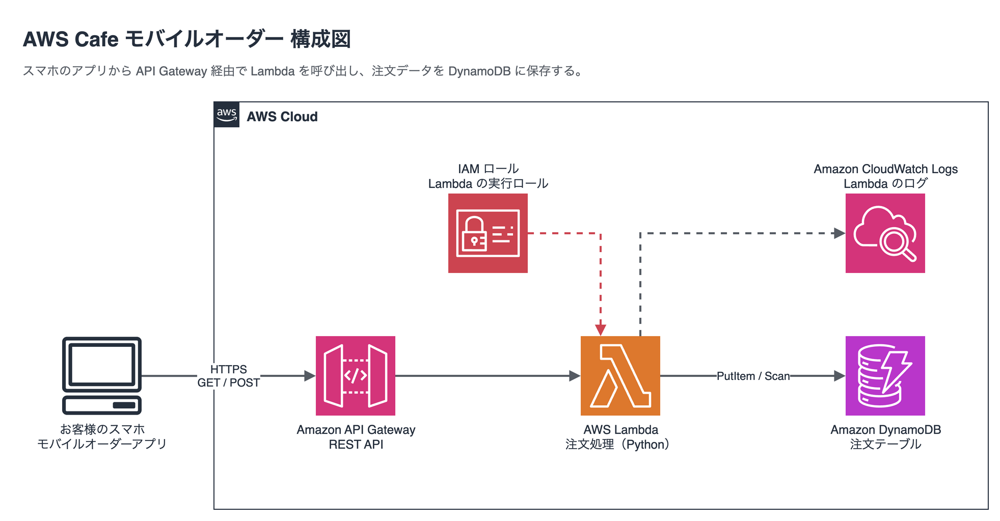

# 00. ストーリーと構成

## ストーリー

今日は人気カフェ「AWS Cafe」の新しいモバイルオーダーアプリのリリース日。

アプリは、開発担当のエンジニアが自分のパソコン（ローカル）で作り上げたもの。ローカルでは、メニューも注文も伝票も完璧に動いていた。そこで今朝、それをそのまま AWS に載せたところ……開店1時間前、アプリが動かなくなってしまった！

> 店長「ローカルではちゃんと動いてたのに…！お客様がもうすぐ来ちゃう、助けてください！」

あなたは呼ばれた AWS エンジニア。開店までにアプリを復旧してください。

## ローカル版を見てみよう

「本来どう動くはずだったのか」は、ローカル版で確かめられます。お客様アプリの URL の末尾を `?local=1` にして開くと、AWS に接続せず、開発担当のパソコンで動いていたときのお店がそのまま動きます。メニューが出て、注文すると伝票が増え、開店成功の画面まで見られます。

ローカルでは問題なかったのに、AWS に持っていったら動かない。現場でもよくある話です。ローカルと AWS で何が違うのかを考えると、原因に近づけます。

## アプリの構成



## お店に例えると

AWS のサービスを、お店の役割に置き換えてみます。

```
 📱 お客様のスマホ（お客様アプリ）
      │  「カフェラテください」
      ▼
 🚪 Amazon API Gateway  ……… 注文の受付窓口
      │  決まった入口（/menu, /orders）で注文を受け付けて、店員さんに渡す
      ▼
 🧑‍🍳 AWS Lambda  ………………… 注文を処理する店員さん
      │  メニューを案内したり、注文を伝票に書いたりする
      │  📓 仕事の記録は業務日報（CloudWatch Logs）に書く
      │  🪪 何をしてよいかは社員証の権限（IAM ロール）で決まる
      ▼
 🧾 Amazon DynamoDB  ………… 注文伝票
         厨房はここを見てドリンクを作る
```

| AWS サービス | お店での役割 | このハンズオンでの名前 |
|---|---|---|
| Amazon API Gateway | 受付窓口 | `aws-cafe-<環境ID>-api` |
| AWS Lambda | 店員さん | `aws-cafe-<環境ID>-order-function` |
| Amazon DynamoDB | 注文伝票 | `aws-cafe-<環境ID>-orders` |
| Amazon CloudWatch Logs | 店員さんの業務日報 | `/aws/lambda/aws-cafe-<環境ID>-order-function` |
| AWS IAM ロール | 店員さんの社員証（できることの一覧） | `aws-cafe-<環境ID>-order-function-role` |

`<環境ID>` は、運営から案内された環境の名前（例: `team01`）に読み替えてください。アプリの上部に「環境：team01」のように表示されています。

トラブルが起きたら「お店のどこで止まっているのか」を考えてみてください。受付窓口なのか、店員さんなのか、伝票なのか。そこが分かれば原因はすぐ近くにあります。

## 受付窓口（API）の入口

| 入口 | 何をする？ | 店員さんの動き |
|---|---|---|
| `GET /menu` | メニューを見る | メニュー表を返す |
| `GET /orders` | 注文伝票の一覧を見る | DynamoDB の伝票を全部読む（Scan） |
| `POST /orders` | 注文する | DynamoDB に伝票を1枚書く（PutItem） |

`GET` は「見せて」、`POST` は「これを登録して」というお願いの種類（HTTP メソッド）です。

次へ → [01. はじめに](01-getting-started.md)
